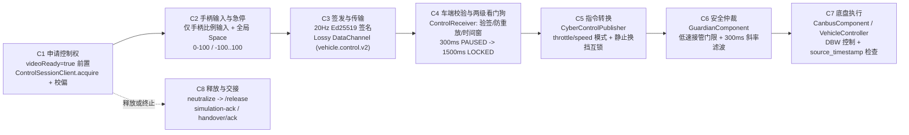
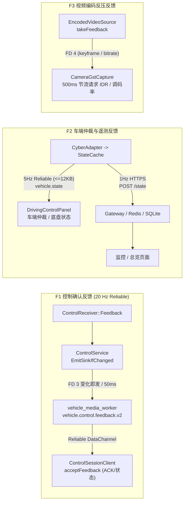

# 视频、控制与反馈全链路流程及异常速查手册

> 本文档基于当前 `livekit-infra`（`v1`）与 `apollo-base`（`v1` + `data/sdk-kit` `v2`）真实代码编写，集中展示**正常流程**、**分阶段异常定位**与**对应代码锚点**，便于后续排障、评审与演进。

---

## 一、快速索引：故障等级总览

| 等级 | 定位原则 | 典型触发场景 | 总体策略 |
| --- | --- | --- | --- |
| **L0** | 瞬时抖动 / 可恢复 HTTP 异常 | `< 300 ms` DataChannel 丢包、单次 `503`/`429`/超时、`DemandGate` 同毫秒重复回包 | 无感吸收或有界重试；不刹车、不断会 |
| **L1** | 短时可恢复中断（`0.3 s – 5 s`） | `RoomEvent.Reconnecting`、DataChannel `300–1500 ms` 暂停、画面停更 `< 5 s`、单相机断流 | 先停用驾驶输入并温和制动保持（`20%–25%`），窗口内恢复后由操作员手动重使能手柄 |
| **L2** | 有界超时 / 主动退出 / 策略拒接 | 断流 `> 1.5 s`、画面失联 `> 5 s`、`15 s` Room 重建失败、租约过期、`409`/维护 `503` | 锁死会话并撤销控制，车端 `STOP`（`50%` 制动），完成交接确认后重新申请 |
| **L3** | 安全关键 / 硬件故障 / 急停 | `Space` 或急停按钮（`brake=100`）、CAN 超时、底盘故障、`SystemStatus` 急停、人工接管 | 无条件抢占执行 `HARD_ESTOP`（含驻车锁）或退回 `MANUAL`，车速归零且故障清除后经 `RESET` 解除 |

---

## 二、视频链路全流程与异常处理

### 2.1 视频正常主链路（阶段 `V1` – `V6`）

```mermaid
flowchart LR
  V1["V1 浏览器租约管理<br/>ViewingLifecycle<br/>30s TTL / 10s 独立续约"]
  V2["V2 Gateway 协调<br/>ViewingLeaseStore (Lua)<br/>续约不改 MediaDemand.revision"]
  V3["V3 车端需求轮询<br/>MediaService::PollDemand (1s)<br/>DemandGate (<=5s 有界截止)"]
  V4["V4 车端按需采集与唤醒<br/>CameraGstCapture (3路 NVENC)<br/>EncodedIngress (2帧) + eventfd"]
  V5["V5 隔离推流进程<br/>vehicle_media_worker (FD 3/4)<br/>发布 camera-left/center/right"]
  V6["V6 浏览器解码与门控<br/>useDrivingCameras + rVFC<br/>三路出帧 => videoReady=true"]

  V1 -->|"POST /viewing/acquire<br/>POST /viewing/{id}/renew"| V2
  V2 -->|"GET /media-demand"| V3
  V3 -->|"generation / VideoRequired"| V4
  V4 -->|"eventfd 零等待唤醒<br/>每次最多排空 6 帧"| V5
  V5 -->|"LiveKit SFU WebRTC<br/>H.264 + capture_time_us"| V6
```

- **正常态关键不变量**：
  - `V1/V2`：续约仅延长 Redis TTL，不递增 `MediaDemand.revision`，防止车端重启媒体 Worker；只有新加入、主动释放或过期才推进 `revision`。
  - `V4`：仅当 `VideoRequired() == true` 时启动硬件采集管线；无人观看且无控车时自动关闭全部 GStreamer 分支。
  - `V6`：驾驶模式启用 `requireFrameCallback: true`，必须三路同时有 `rtpTimestamp`/`presentedFrames` 推进才置 `videoReady = true`。

### 2.2 视频链路分阶段异常速查表

| 阶段 | 异常场景 | 等级 | 处理逻辑 | 代码锚点 |
| --- | --- | --- | --- | --- |
| **V1/V2** | `acquire`/`renew` 遇瞬时 `503`/`429`/网络超时 | **L0** | `acquire` 最多短重试 2 次；`renew` 在本地截止期前指数退避重试 | `frontend/src/lib/viewing-api.ts` `frontend/src/lib/viewing-lifecycle.ts` |
| **V1/V2** | 维护排空 `503`（`MANAGED_MAINTENANCE_REQUIRED`）或 `409` 过期/释放 | **L2** | 立即停止重试并关闭监看，提示重新申请；不复用旧 `viewing_session_id` | `frontend/src/lib/viewing-api.ts` `teleop-gateway/internal/gateway/viewing_lease_api.go` |
| **V2** | Gateway Postgres 单实例锁或管理写阻塞导致 `503` | **L0** | `instanceMu` 与 `additiveMu` 分离 + `1.5s` `PingContext` 超时，避免管理写阻塞 `/media-demand` | `teleop-gateway/internal/gateway/managed_runtime.go` |
| **V3** | 车端 `PollDemand` 遇到 `503` 或同毫秒 `server_time_ms` 重复包 | **L0** | 捕获异常并忽略同毫秒/过期回包，**不调用 `Fail()`**，保留未过期的 5s `deadline` | `apollo-base/modules/teleop/src/media/media_service.cc` `apollo-base/modules/teleop/src/media/media_demand.cc` |
| **V3** | 浏览器崩溃或断网超过 `5s`（车端）/ `30s`（Gateway） | **L2** | `DemandGate::Current` 到期停推并关闭采集管线；`ViewingLease` 30s TTL 自动回收 | `apollo-base/modules/teleop/src/media/media_demand.cc` `teleop-gateway/internal/gateway/viewing_lease.go` |
| **V4** | 单路相机卡顿 `>5s` / GStreamer Bus 错误 / IPC 阻塞丢帧 | **L1** | 仅关闭并 `2s` 重试故障分支，调用 `Discontinuity(cam)` 请求该路 IDR，**不连坐兄弟相机** | `apollo-base/modules/teleop/src/camera_gst/camera_gst_capture.cc` `apollo-base/data/sdk-kit/livekit/encoded_video.cc` |
| **V5** | 单路编码 PTS 倒退或漂移 `>500 ms` | **L1** | `media_backend` 仅置该路 `waiting_keyframe[cam]=true`、清 `base_pts[cam]` 并请求 IDR，**不崩溃 Worker** | `apollo-base/data/sdk-kit/livekit/media_backend.cc` |
| **V5** | `vehicle_media_worker` 自身异常退出 | **L2** | `MediaService` 立刻 `Invalidate("media_worker_failed")` 锁闭控制，停机 `1s` 后在有效需求下重启 | `apollo-base/modules/teleop/src/media/media_service.cc` |
| **V6** | LiveKit `RoomEvent.Reconnecting`（短时 ICE 抖动） | **L1** | **保留现有 `tracks` 与 `<video>` DOM**（避免强制重等 3 路 IDR 黑屏），`Reconnected` 后同步已有出帧状态并解除恢复锁 | `frontend/src/hooks/use-driving-cameras.ts` |
| **V6** | 单路/多路停更（自适应 `T_frame_stall ∈ [900, 1500] ms`）或 `waiting`/`stalled` | **L1→L2** | `ThreeCameraView` 首帧后**弱依赖保留画面不黑屏**，仅右上角提示；`DrivingControlPanel` 保持 5s 温和保刹（5s 内恢复由手柄 `needsNeutral` 直接续控），超时自动释放交接 | `frontend/src/lib/camera-feed.ts` `frontend/src/pages/ThreeCameraView.tsx` `frontend/src/pages/DrivingControlPanel.tsx` |
| **V6** | LiveKit `RoomEvent.Disconnected` 或 `TrackSubscriptionFailed` | **L1→L2** | `15 s` 恢复窗口内通过 `POST /viewing/{id}/token` 换票重建最多 3 次 Room（递增 `playbackEpoch`）；三路全出帧才退出 `recovering` | `frontend/src/lib/viewing-lifecycle.ts` `frontend/src/hooks/use-driving-cameras.ts` |

---

## 三、控制链路全流程与异常处理

### 3.1 控制正常主链路（阶段 `C1` – `C8`）

- **正常态关键不变量**：
  - **仅手柄驾驶**：工作台已移除键盘 WASD/方向键驾驶，避免离散 100% 输入与双套逻辑；`Space` 键及底栏红色急停按钮在任何 `ready` 态均可独立触发 `brake: 100` 全制动。
  - **先保刹接管、再驱动**：推荐在 `READY` 后点击 `请求接管（制动保持）` 发送与当前车轮转角对齐的 `throttle=0, brake=20%` 切入 `REMOTE`，再启用手柄。
  - **纵向可配模式**：支持 `throttle`（`0–100%` 油门）与 `speed`（按 `max_remote_speed_mps` 映射至 `ControlCommand.speed`，默认 `5.0 m/s`），`Guardian::CanEnterRemote` 对两种模式均强制低速接管门控。

### 3.2 控制链路分阶段异常速查表

| 阶段 | 异常场景 | 等级 | 处理逻辑 | 代码锚点 |
| --- | --- | --- | --- | --- |
| **C1** | 控制申请遇 `503`（瞬时 vs 策略门禁） | **L0/L2** | 瞬时 `503` 短重试最多 2 次；实车受管门禁/维护 `503` 或 `409` 不重试且退回 `idle`（仅 `status=0` 超时锁 `locked`） | `frontend/src/lib/control-session-client.ts` `teleop-gateway/internal/gateway/control_session_api.go` |
| **C1/C2** | 窗口失焦、页面隐藏、`editable_focus`、手柄断连 | **L1→L2** | 立刻 `suspend` 停用手柄发中立帧；`page_hidden` 保留短时宽限（`3s`），超时升级 `page_unload` 释放 | `frontend/src/lib/control-safety.ts` `packages/teleop-shared/src/gamepad-input.ts` |
| **C2** | 控车中画面短暂中断（`videoReady=false`） | **L1→L2** | 立即停用手柄，若已 `REMOTE` 且非急停则发送 `20%` 温和制动保持（`brake=20`）；5s 内恢复且手柄经 `needsNeutral` 回中直接续控；超 5s **自动断开、自动释放交接回 `closed`** 并保留红色故障提示 | `frontend/src/pages/DrivingControlPanel.tsx` `packages/teleop-shared/src/gamepad-input.ts` |
| **C3** | 控制 Room `Reconnecting`（`< 1.2s` 短断） | **L1→L2** | 停用手柄并暂停发包最多 `rtcReconnectGraceMs`（Gateway `timing_policy` 统一下发，默认 `1200 ms`）；重连后置 `throttle=0` 并保留在途 `pendingCommands` 待核销；超时自动释放交接 | `frontend/src/lib/control-session-client.ts` `teleop-gateway/internal/gateway/control_session_api.go` |
| **C3** | 租约续期遇 `503`/网络抖动 vs `409` | **L0/L2** | 截止期前指数退避重试；遇 `409` 或超时立即 `fail` 断开控制 Room 并释放 | `frontend/src/lib/control-session-client.ts` |
| **C4** | 车端 DataChannel 断流 `300 – 1500 ms` | **L1** | `ControlReceiver` 进入可恢复 `PAUSED`（`command=null`）；恢复首包要求 `throttle == 0`，否则拒收 `recovery_requires_neutral` | `apollo-base/modules/teleop/src/control/control_receiver.cc` |
| **C4** | DataChannel 断流 `> 1500 ms` / `ControlContext` 5s 超时 / 篡改重放 | **L2** | `ControlReceiver` 永久锁死 `LOCKED`（同会话不再接收指令）；`Poll` 在错误时保持剩余 5s 期限，不因单次 `503` 误锁 | `apollo-base/modules/teleop/src/control/control_receiver.cc` `apollo-base/modules/teleop/src/control/control_service.cc` |
| **C5** | 行驶中请求反向挡位（如前进中切 `R` 挡） | **L1** | `CyberControlPublisher` 与 `Guardian::EnforceRemoteGearInterlock` 双重拦截，保持原挡位直到车速 `<= 0.1 m/s` 且有制动 | `apollo-base/modules/teleop/src/cyber/cyber_adapter.cc` `apollo-base/modules/guardian/guardian_component.cc` |
| **C5/C6** | `PAUSED` 保持 vs `LOCKED` / `Space` 急停 | **L1 / L3** | `PAUSED` 每 `200 ms` 下发 `START + brake=25%` 温和保刹；`LOCKED` 发 `STOP + brake=50%`；`brake>=100` 发 `STOP + brake=100% + parking_brake` | `apollo-base/modules/teleop/src/cyber/cyber_adapter.cc` `apollo-base/modules/teleop/src/control/control_service.cc` |
| **C6/C7** | `/apollo/teleop/control` 失联 `>300 ms`、CAN 超时、底盘/Monitor 故障、人工接管 | **L3** | `Guardian` 直接抢占执行 `HARD_ESTOP`（保持当前转向角、`50%` 制动 + 驻车）或退回 `MANUAL`；`Canbus` 校验真实 `source_timestamp_sec` | `apollo-base/modules/guardian/guardian_component.cc` `apollo-base/modules/canbus/canbus_component.cc` |
| **C8** | 控制释放或过期后的交接确认 | **L2** | `simulation` 自动调 `/control/simulation-ack`；`cyber` 模式结合 `StateCache` 核验已退出 `REMOTE` 后上报 `/control/handover/ack` | `apollo-base/modules/teleop/src/control/control_service.cc` `teleop-gateway/internal/gateway/control_handover_api.go` |

---

## 四、反馈链路全流程与异常处理

### 4.1 三条反馈链路总览（阶段 `F1` – `F3`）

### 4.2 反馈链路分阶段异常速查表

| 链路 | 异常场景 | 等级 | 处理逻辑 | 代码锚点 |
| --- | --- | --- | --- | --- |
| **F1** | 控制反馈超时（`>1000 ms` 或首次 `>5000 ms`）或 ACK 超过 `600 ms` | **L2** | `ControlSessionClient.checkDeadlines` 在消费迟到 ACK 前先判定超时，立即 `fail` 锁死会话并断开控制 Room | `frontend/src/lib/control-session-client.ts` |
| **F1** | 重连前在途指令的 `Reliable` ACK 在 `Reconnected` 后补传到达 | **L0** | `setRtcReconnecting(false)` 保留 `pendingCommands` 并刷新 `dispatchedAt = now`，正常核销补传 ACK，不误报 `unexpected_ack` | `frontend/src/lib/control-session-client.ts` |
| **F1** | 伪造发送者、`Unreliable` 信道、`receiver_instance_id`/`revision` 跳变、`last_rejection` | **L2/L3** | `acceptFeedback` 立即 `fail` 锁闭前端会话并要求释放重建；`CyberControlPublisher` 抑制重复 `accepted_sequence` 不误续看门狗 | `frontend/src/lib/control-session-client.ts` `apollo-base/modules/teleop/src/cyber/cyber_adapter.cc` |
| **F2** | `vehicle.state` 超过 `12 KB` 字节上限（如 `SystemStatus` 消息过多） | **L0** | `EncodeRTCState` 优先裁剪 `system_status`/`mission_*` 并**保留 `sources["vehicle_status"]`**；前端遇 `sources_omitted` 时保留已有仲裁状态 | `apollo-base/data/sdk-kit/livekit/media_backend.cc` `apollo-base/modules/teleop/src/common/state_cache.cc` `frontend/src/pages/DrivingControlPanel.tsx` |
| **F2** | 车辆 HTTP `/state` 上报遇 `503` 或网络抖动 | **L0** | `TelemetryService::Step()` 捕获异常并 `10s` 节流打印错误，不影响 `MediaService` 视频与控制闭环 | `apollo-base/modules/teleop/src/data/telemetry_service.cc` |
| **F3** | 弱网码率突变或关键帧连续请求 | **L0** | `CameraGstCapture` 内设 `500 ms` 关键帧最小间隔节流，并将目标码率钳位在 `[64 kbps, config.bitrate_bps]` 内（仅支持 `nvv4l2h264enc`） | `apollo-base/modules/teleop/src/camera_gst/camera_gst_capture.cc` `apollo-base/modules/teleop/src/camera_gst/camera_gst_adapter.cc` |

---

## 五、端到端可跟踪性（Observability）设计与日志导出位置

本方案遵循“**热路径只记内存与原子计数、状态跃迁才异步上报、各端日志职责分明**”原则，以 `viewing_session_id`、`session_id + accepted_sequence`、`X-Request-ID` 为三条串联脊柱，串联 **浏览器 ↔ Gateway ↔ 车端 Edge/Cyber**。

### 5.1 日志保存在哪里？如何导出？

| 端 | 存储与导出方式 | 包含内容 | 隐私与开销约束 |
| --- | --- | --- | --- |
| **浏览器端** | **浏览器本地导出下载**：平时仅保存在页面内存环形缓冲（控制 128 条 + 视频/反馈时间轴 256 条），点击工作台“导出近期遥操作诊断”在浏览器本地下载 `teleop-diagnostics.json` | 同单调时钟轴（`performance.now()`）下的控制 `tick/ack/fault`、视频 `room_reconnecting/disconnected/camera_stalled/media_pause_hold`、`sources_omitted` 裁剪标记 | 不自动上传服务器；禁止包含 Bearer Token、Ed25519 私钥/签名或原始控制载荷 |
| **Gateway 服务端** | **服务端标准输出（JSON） + `/metrics`**：所有 `AuditEvent`（含浏览器控车与车端安全跃迁）输出到 Gateway stdout（由 Docker Compose 日志驱动收集），指标暴露在 Prometheus `/metrics` | `X-Request-ID`、租约/交接审计事件、车端上报的 `paused_hold`/`watchdog_timeout`/`emergency_stop`/`command_rejected`、`teleop_gateway_503_total{code}`、`teleop_media_demand_revision`、`teleop_e2e_latency_p99_milliseconds` | 非阻塞标准输出；503/审计标签仅限固定枚举 |
| **车端（Apollo）** | **车端本地日志 + 低频异步上云**：`MediaService` 每 `10 s` 输出一行周期摘要、`CyberControlPublisher` 在 `LOCKED`/`ESTOP` 输出 `accepted_seq ↔ cyber_seq` 到车端本地日志；安全跃迁由 `ControlService::Poll()` 复用 `TeleopClient` 异步上报 Gateway `/api/audit/events` | `demand_ok`/`demand_err`/`frames_sent`/`frames_dropped`、`accepted_seq ↔ cyber_seq`、`ControlCommand.latency_stats.total_time_ms`、及上云的 `paused_hold`/`watchdog_timeout`/`emergency_stop` | 零新增线程、零同步阻塞；`pending_audits_` 上限 8 条且仅在状态跃迁入队 |

### 5.2 各链路已落地追踪锚点

| 链路 | 已落地追踪能力 | 代码锚点 |
| --- | --- | --- |
| **控制链路（C1–C8）** | • 浏览器 `ControlSessionClient.diagnostics` + 合并导出 `teleop-diagnostics.json` • 车端 `ControlService` 在 `PAUSED`/`LOCKED`/`command_rejected`/`emergency_stop` 跃迁时自动上报 `/api/audit/events` • `CyberControlPublisher` 填充 `ControlCommand.latency_stats.total_time_ms` 并在 `LOCKED`/`ESTOP` 记录 `accepted_seq ↔ cyber_seq` | `frontend/src/lib/teleop-diagnostics.ts` `frontend/src/pages/DrivingControlPanel.tsx` `apollo-base/modules/teleop/src/control/control_service.cc` `apollo-base/modules/teleop/src/cyber/cyber_adapter.cc` |
| **视频链路（V1–V6）** | • 浏览器 `useDrivingCameras` / `LiveWorkbench` 记录 `room_reconnecting`/`reconnected`/`disconnected`、`camera_stalled`/`live`、`camera_stats`（`ema_ms`/`budget_ms`/`max_ms`）、`media_pause_hold` • 车端 `MediaService` 每 10s 输出 `[teleop_media_summary]`（`demand_ok`/`demand_err`/`frames_sent`/`frames_dropped`） • 车端 `capture_time_us` 已写入 `user_timestamp_us`（浏览器端 `captureTime` 年龄分位数留待实机标定） | `frontend/src/hooks/use-driving-cameras.ts` `frontend/src/pages/LiveDriving.tsx` `frontend/src/lib/camera-feed.ts` `apollo-base/modules/teleop/src/media/media_service.cc` [`video-freshness-verification.md`](video-freshness-verification.md) |
| **反馈与 503 监控** | • Gateway `/metrics` 暴露 `teleop_gateway_503_total{code}`、`teleop_audit_events_total`、`teleop_media_demand_revision`、`teleop_e2e_latency_p99_milliseconds` • 浏览器时间轴记录 `vehicle_state_sources_omitted` | `teleop-gateway/internal/gateway/app.go` `teleop-gateway/internal/gateway/audit.go` `teleop-gateway/internal/gateway/request_diagnostics.go` |

---

## 六、自动化端到端测试索引与相关文档

- **自动化集成与端到端测试（覆盖正常链路与 L0/L1/L2/L3 异常）**：
  - 前端 + 共享状态机 + Ed25519 模拟车端 E2E：`frontend/scripts/teleop-e2e-test.mjs`（已纳入 `cd frontend && npm test`）
  - Gateway HTTP + Redis 协调集成：`teleop-gateway/internal/gateway/teleop_e2e_integration_test.go`
  - 车端 Apollo C++（`DemandGate` + `EncodedIngress` + `ControlReceiver` + `CyberControlPublisher` + `GuardianComponent` + `EncodeRTCState`）：`apollo-base/modules/teleop/tests/teleop_e2e_flow_test.cc`（`//modules/teleop:teleop_e2e_flow_test`）
- **相关文档导航**：
  - 模块职责与安全不变量：[`vehicle-cyber.md`](vehicle-cyber.md)
  - 容错演进与参数边界：[`remote-control-resilience.md`](remote-control-resilience.md)
  - 浏览器端到端画面新鲜度校验：[`video-freshness-verification.md`](video-freshness-verification.md)
  - 常见部署与运行排障：[`troubleshooting.md`](troubleshooting.md)
