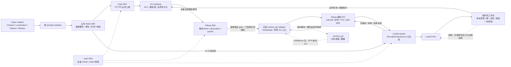
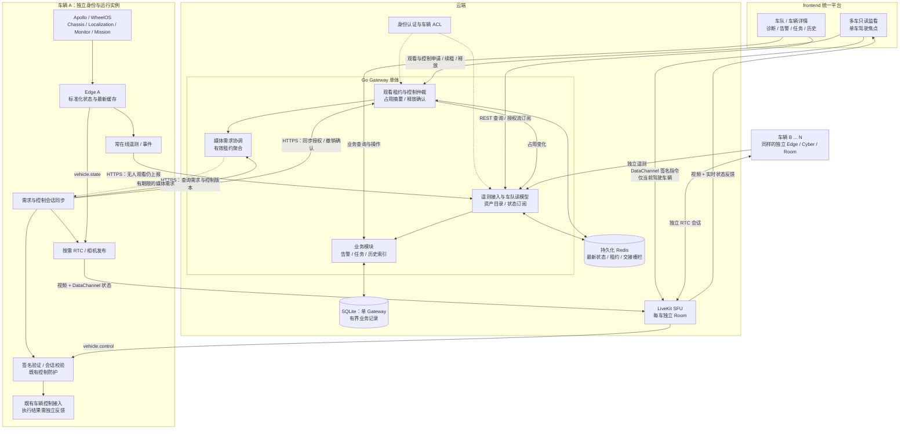
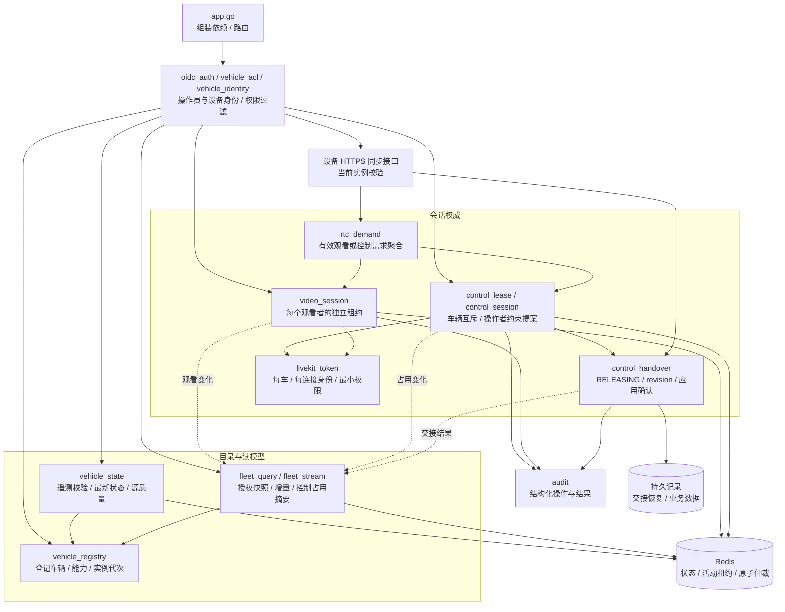
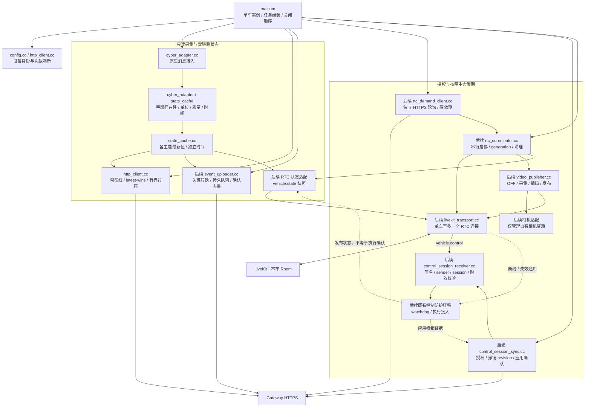
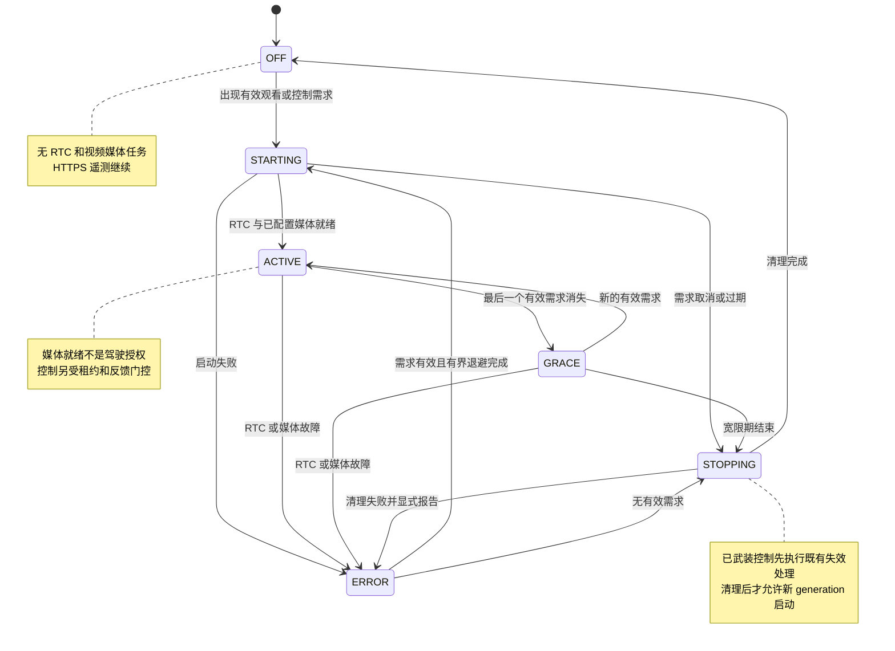
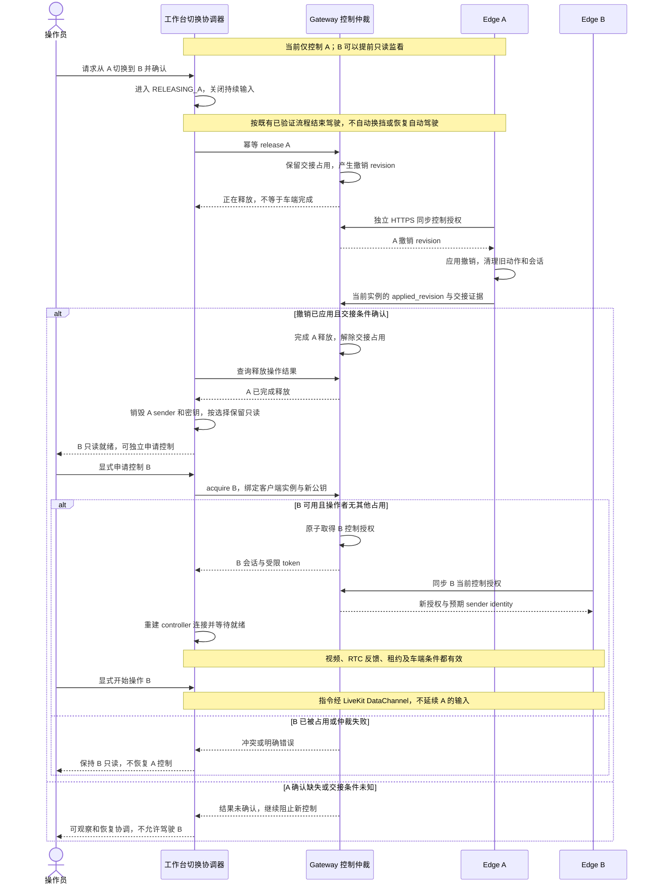

# 自动驾驶运营平台架构与模块图

日期：2026-10-30

状态：目标设计图，不代表端到端验收；服务端租约和单操作者栅栏已实现，车辆物理交接仍须独立批准和验证。

技术选型：Go 服务端、React/TypeScript 客户端、C++17/Cyber 车端后台。
下列 Edge 媒体已有原生 SDK/合成相机闭环，真实相机和控制模块仍为后续门槛。
已落地独立遥测、观看租约、多车只读面板及有界 SQLite 业务记录；
原生媒体和各阶段实际进度见实施计划，不将目标图视为验收证据。

### SDK + Cyber 数据通路（本轮细化）

编码视频 adapter、IPC 和 LiveKit 编码源已实现，并用离线 H.264 AU 验证实际 RTC 解码；
不代表已挂接 Apollo 的真实 camera_gst 分支。共享相机的采集不能因无人远程观看而停止。
纯远程驾驶只安装 Auth + Teleop，公共状态/配置/HTTP 随 Auth 包交付；
Data SDK 是可选运营扩展，不在 Teleop 的依赖链中。交付方案见
[双 SDK 计划](../.agents/teleop-sdk-plan.md)。

设计依据：[框架、模块与目录](frontend-platform-architecture.md)、
[数据接入与实施计划](frontend-data-integration-plan.md)。

图中模块是逻辑边界，Gateway 首期保持单体。Mermaid 可在 GitHub Markdown 中渲染。
总体图箭头表示主要数据方向；模块图箭头表示调用/依赖方向，虚线表示反馈或跨边界同步。

## 1. 总体架构与双链路

**边界：**常在线遥测不依赖 RTC；驾驶指令不经过业务遥测接口；无人观看且无控制需求时关闭 RTC 和视频。
Mission 任务业务下发属于独立业务通道，不能借用驾驶 DataChannel；其详细接口在任务模块阶段细化。

## 2. 前端模块与多车资源所有权

```mermaid
flowchart TB
    subgraph App["app/"]
        Shell["PlatformLayout / routes<br/>AuthProvider / 导航保护"]
    end
    subgraph Pages["pages/"]
        Fleet["FleetPage / VehiclePage"]
        TeleopPage["TeleopWorkbench"]
        BizPages["AlertsPage / TasksPage / 历史"]
    end
    subgraph Features["features/"]
        Vehicles["vehicles/<br/>目录 / 能力 / 遥测 / 控制占用读模型"]
        BizFeatures["alerts/ tasks/ history/<br/>业务服务与页面状态"]
        subgraph Teleop["teleop/：唯一驾驶上下文"]
            Switch["switch-machine<br/>A 释放后再申请 B"]
            Coordinator["control-coordinator<br/>控制租约 / 就绪门控"]
            Sender["secure-control-sender<br/>单一发送器 / 会话密钥"]
        end
        subgraph Monitoring["monitoring/：每车独立实例"]
            Registry["room-registry<br/>资源预算 / 引用管理"]
            RoomA["vehicle-room A<br/>观看租约 / 轨道 / RTC 状态"]
            RoomB["vehicle-room B ... N<br/>各自观看租约与 generation"]
        end
    end
    subgraph Lib["lib/"]
        Contracts["contracts/<br/>类型 / 运行时校验 / 版本适配"]
        API["api/client + stream<br/>授权请求 / 游标 / 重新同步"]
        SDK["LiveKit SDK<br/>每车 Room 实例"]
    end

    Shell --> Fleet
    Shell --> TeleopPage
    Shell --> BizPages
    Fleet --> Vehicles
    BizPages --> BizFeatures
    TeleopPage --> Vehicles
    TeleopPage --> Switch
    TeleopPage --> Registry
    Switch --> Coordinator
    Coordinator --> Sender
    Coordinator --> Registry
    Registry --> RoomA
    Registry --> RoomB
    Sender -->|"只绑定当前驾驶 Room"| Registry
    Vehicles --> API
    BizFeatures --> API
    Coordinator --> API
    RoomA --> API
    RoomB --> API
    RoomA --> SDK
    RoomB --> SDK
    Vehicles --> Contracts
    Coordinator --> Contracts
    RoomA --> Contracts
    RoomB --> Contracts
```

**资源归属：**读模型按 `vehicle_id` 存储；每车连接按 `vehicle_id + generation` 隔离。
Room、sender、私钥由生命周期服务持有，不写入持久化 store。多车可看，驾驶焦点唯一。

## 3. Gateway 模块与权威事实

**权威区别：**租约决定谁有授权；Edge 反馈决定是否应用撤销；车辆状态和交接条件决定能否完成交接。
普通车队列表仅接收授权摘要，不读取完整控制会话或密钥材料。

## 4. Edge 模块与独立任务

**故障隔离：**遥测与 RTC 独立背压；视频失败不阻塞状态上报；RTC 重连不恢复旧驾驶动作。
OFF 关闭采集、编码、发布和 RTC，但业务遥测与需求同步继续运行。

## 5. 按需 RTC / 视频生命周期

发生清理错误时不得盲目再启动一组任务；先确认旧资源已回收，再允许重试。
宽限期仍可能发送视频，允许配置为零；房间存在与否不是有效需求。

## 6. A 车释放后切换到 B 车

该图表达的是拟增加的交接栅栏。当前 HTTP release 及 `vehicle.state` 不能直接提供完整确认；
具体车辆交接条件必须先定义并验证。异常恢复不能因租约 TTL 到期或 Gateway 重启被绕过。
