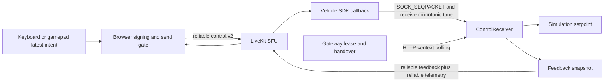

# Control latency and `stale_command`: review and proposed design

Date: 2026-11-11. Scope: `op-01`, `car-103`, the LAN simulation deployment, its browser client, Gateway, LiveKit transport, and the vehicle receiver. Times below are UTC unless explicitly marked CST (UTC+8).

**Status:** The requested temporary timestamp tolerance is implemented and tested for **simulation only**. The browser hardening and diagnostics described below are now implemented in this repository. The cross-component industrial design remains a proposal. During the original review, the vehicle executable was rebuilt; no vehicle runtime was running, and none was started. The receiver change takes effect on the next launch of that executable. No commits, lease deletion, clock correction, or broader transport changes were performed.

### Repository implementation follow-up

Implemented in `frontend/src/lib/control-session-client.ts` and the simulation panel:

- Recheck lifecycle, media readiness, the monotonic lease/feedback deadlines, and the 250 ms signing/publication budget immediately after signing and after publication. Discard superseded intent before enqueue. A completion at exactly 250 ms locks control even if the interval callback has not run.
- Keep unique signed sequences, but accept advancing acknowledgements only for dispatched commands. A cumulative acknowledgement retires older dispatched commands; discarded signatures create no acknowledgement debt. Each oldest outstanding dispatch has a 450 ms acknowledgement deadline (the former six nominal 75 ms intervals); repeated feedback does not extend it, and an overdue ACK cannot revive it. This is a browser simulation liveness policy, not a receiver freshness guarantee. Pending dispatch metadata is capped at 64 entries.
- Disconnect RTC on the first latched fault to stop resume/replay attempts. Already-enqueued packets still depend on receiver validation; disconnect is not a cancellation guarantee. Reconnection cannot rearm the existing client.
- Preserve the first fault through subsequent transport errors and successful/failed release. Display cleanup status separately, retain the Gateway handover fence, and sanitize transport cleanup errors.
- Export a local ring of the latest 128 timing events from the simulation panel. Events contain browser monotonic time, sequence, intent revision, tick gaps, signing/publication durations, dispatch-to-ACK RTT, pending count, remaining lease horizon, fixed fault categories, and local wall-minus-monotonic elapsed change. Snapshots contain no credentials, signed bodies, arbitrary transport errors or command values. These are local browser measurements; ACK RTT includes feedback scheduling and is not one-way command age.

Regression coverage in `frontend/scripts/test.mjs` includes both original reproductions, exact send/ACK boundaries, deadline expiry before timer callbacks, signature cancellation, ACKs during an unresolved publish, count/memory bounds, and fault preservation through cleanup. The evidence script below now asserts the corrected behavior. Validation: frontend tests and production build, plus the standalone evidence script. No deployment or live vehicle test is part of this follow-up.

Still outstanding: receiver-owned freshness tickets and v3 capability negotiation across Gateway/browser/SDK-Kit/Apollo, coordinated lossy control and feedback transport, receiver/worker queue instrumentation, clock exchange, video scene-age measurement, idempotent acquisition recovery, token refresh changes, and the live fault-injection/platform/24-hour qualification runs. The Apollo/SDK-Kit sources are outside this checkout; do not enable a browser-only wire change or claim production freshness from this follow-up.

## 1. Conclusions

1. **Clock offset is a confirmed contributor to the observed `stale_command`.** On November 10 the vehicle was approximately 254 ms ahead of the Mac; the receiver's original maximum command age was 250 ms. An independent NTP query measured about 258 ms. These values consume the entire age budget before network delivery. On November 11 a new sample found approximately 164 ms of offset. Neither sample is a measurement of command transport latency, and the two samples do not prove a monotonically increasing delay.
2. **The continuous-command transport can retain obsolete data.** Commands use reliable delivery. The installed JavaScript SDK has buffering, flow-control waits, and replay across resume. Vehicle feedback and telemetry also use reliable delivery. The application's one-in-flight guard does not establish an end-to-end queue-age bound. This is a credible accumulation mechanism, but the retained logs do not prove that it caused this incident.
3. **Two additional client defects are reproducible without a vehicle:** a late signature can pass the pre-publication checks after its time budget; locally discarded signatures can inflate the acknowledgement-distance counter and cause a false lock. They explain possible failures under delay, not the complete historical latency ramp.
4. **The 409 and long handover delay are a separate lifecycle problem.** Retained logs contain one 663.718-second interval from acquisition to handover confirmation. Confirmation coincides with a new vehicle process startup. This is consistent with a vehicle process being unavailable, not evidence of 663 seconds of command buffering.
5. **Host suspension is another observed source of interruption.** LiveKit's delayed-status warnings after the testing period correlate with Mac sleep/wake events. The laptop deployment is unsuitable as an unattended service host. The first such retained warning occurred after the last control activity in the inspected log window, so it does not establish the cause of the earlier command failures.

Recommended direction: **short, receiver-enforced freshness deadlines; latest-value control transport; monotonic timing with explicit uncertainty; independent watchdogs; and measurements at every queue boundary.** A two-minute command window is a simulation diagnostic accommodation, not the production solution.

## 2. Immediate change, ownership, and validation

The receiver source is not in this checkout. The relevant deployed vehicle checkout is:

| Item | Reviewed location/version |
| --- | --- |
| This repository | `remote-infra`, base commit `975eb290b9d0b2a3af37f1216a0078d2732deadd`, plus existing working-tree changes |
| Vehicle host | `10.0.39.103` |
| Vehicle source | Host `/home/dht/apollo-base`, mounted as `/apollo` in `apollo_dev_dht_f9ad405b` |
| Apollo base revision | `833a8c2fafdc6813a00fceda605d70abd331df5b` |
| SDK-Kit revision | `dd31f13cc2f1155beca343b2590204d9bddd3754` |
| Browser SDK inspected | Installed `livekit-client` 2.23.0 |
| Vehicle SDK dependency | `livekit_sdk` 1.13.0, local BCR overlay including a patched FFI library |
| Gateway/SFU/frontend | Local `authentication-test-*` Docker containers on the Mac |
| Verified console endpoint | `https://10.0.39.138:8443`; the earlier reported `9443` endpoint was not established by this investigation |

In subsequent references, **V:** means `/apollo` in that vehicle container. **S:** means `V:data/sdk-kit`. Function names and line numbers refer to the inspected source snapshot, with the timestamp patch applied where relevant.

Changed `V:modules/teleop/src/control/control_receiver.cc` and its neighboring `control_receiver_test.cc`:

| Check | Simulation now | Cyber mode / other checks |
| --- | --- | --- |
| Signed wall-clock timestamp in the past | Accept through 120,000 ms inclusive | Original 250 ms inclusive |
| Signed wall-clock timestamp in the future | Accept through 120,000 ms inclusive | Original 100 ms inclusive |
| Time from worker receive callback to receiver processing | Unchanged: reject at 250 ms | Unchanged |
| Time without an accepted command after the first accepted command | Unchanged: watchdog at 300 ms | Unchanged |
| Receiver authority refresh horizon | Unchanged: at most 500 ms from request start | Unchanged |
| Browser signing/publication stall check | Unchanged: 250 ms, checked by `tick()` | Unchanged |
| Browser feedback silence timeout | Unchanged: 750 ms after feedback has begun | Unchanged |
| Signature, sender, session, receiver instance, revision and sequence checks | Unchanged | Unchanged |

The constructor flag used by `ControlService` is derived from the local `control_mode == "simulation"`; a browser cannot select this tolerance through a packet field. The existing Gateway simulation allowlist and vehicle mode checks remain in place.

**Important limitation:** the 300 ms watchdog detects a gap in accepted traffic. It cannot distinguish a smooth stream of delayed commands from a fresh stream. A buffered stream arriving every 75 ms could remain live under the relaxed timestamp window. This is why the exception is restricted to the simulator and must be removed before production qualification.

The exact external-source change is preserved in [the patch](patches/2026-11-11-simulation-command-age.patch). Original files were also backed up in the vehicle container at `/tmp/teleop-command-age-before-20261111/`. The patch is already applied to the reviewed checkout; do not apply it twice.

Validation completed:

```bash
# In the vehicle container, /apollo, as dht:
bazel test --config=dev --lockfile_mode=off \
  //modules/teleop:control_receiver_test --test_output=errors
bazel build --config=dev -c opt --lockfile_mode=off \
  //modules/teleop:vehicle_telemetry
```

The receiver test passed, including both inclusive boundaries, one millisecond outside each boundary, the measured 254 ms skew, unchanged Cyber thresholds, replay/signature checks, and a 301 ms watchdog expiry after a skewed simulation command. The optimized vehicle executable built successfully. The initial command without `--config=dev` failed to resolve `livekit_sdk@1.13.0` in the public registries; the existing documented dev configuration selects the local registry and SDK. No module-lockfile workaround was introduced.

Built executable: `V:bazel-bin/modules/teleop/vehicle_telemetry`, resolving to the existing `k8-opt` output path. SHA-256:

```text
97cb428073e029f03b2c2c28039afb3764c876d61487e1ed8b59c7df6c3946e8
```

No live driving or end-to-end soak test was performed. The simulator was stopped. The tests above validate the threshold change, not the proposed design or elimination of accumulated latency.

## 3. Evidence and what it establishes

### 3.1 Clock measurements

Measurements used a persistent SSH process returning the vehicle host's real-time nanosecond clock. For each exchange, the local send/receive midpoint was compared with the remote clock. Half the round-trip time is an uncertainty bound for this simple measurement; it is not a one-way network-latency measurement. The first sample includes process startup and is excluded from the useful estimates.

| Observation | Result | Interpretation |
| --- | --- | --- |
| November 10 persistent SSH samples | Vehicle ahead by roughly 253–256 ms, useful RTT 6–11 ms | Enough offset to explain crossing the original past-age threshold |
| November 10 NTP query from Mac to `210.28.130.4` | `+0.257910 +/- 0.047405` seconds | Independent support for a slow Mac clock |
| November 11 repeated sample burst | Low-RTT estimates 163.1–163.8 ms, RTT about 7 ms | Offset remains material; change between days is not proof of a transport queue ramp |
| November 11 Gateway-container versus Mac | Approximately -0.02 to -0.05 ms, RTT 0.33–0.48 ms after startup | Calibrating only to Gateway time would not correct the vehicle-versus-browser offset |
| November 11 vehicle `chronyc tracking` | Synchronized, reported system offset about 0.037 ms slow, selected source `210.28.130.4` | Vehicle time service reports healthy discipline; this is its estimate, not an independent sub-millisecond guarantee |

No Windows clock sample, browser signing-duration trace, or application command RTT was captured. Windows having the same symptom does not establish the same numerical clock error.

### 3.2 Gateway audit

The current Gateway container retains relevant events from November 10, 12:04:54 through 13:12:32: **58 acquisitions, 51 explicit releases, 3 renewals, and 58 simulation-handover confirmations**. Older logs may be in replaced containers and were not recovered. These counts concern the inspected deployment's events, not a guaranteed history of every test.

Selected correlations:

| Session prefix | Events | Observed interval |
| --- | --- | --- |
| `f6627ffe` | Acquire 12:51:55.340594 → confirmed 13:02:59.058594 | 663.718 s; no release/renew in the retained interval |
| `41f669ad` | Release 12:51:01.493663 → confirmed 12:51:19.901072 | 18.407 s |
| Several other sessions | Acquire → confirmed without explicit release | About 30.0–30.1 s, consistent with normal lease expiration |

Vehicle log filenames show process starts at 12:51:19 and 13:02:59, matching the two delayed confirmations. The 13:02:59 Cyber initialization log begins at 13:02:59.061982. This supports investigating vehicle process availability and context polling. It does not identify a queued-command age.

HTTP 409 is generated for `ErrControlLeaseHeld` or `ErrControlHandoverPending` in `apps/teleop-gateway/internal/gateway/control_session_api.go:220`. The Redis handover guard deliberately survives lease expiry. Deleting it to clear the UI would bypass the vehicle-confirmation boundary. The previous frontend change exposing the two 409 reasons is separate from the timestamp patch.

### 3.3 Vehicle and LiveKit logs

Vehicle INFO files show Cyber reader-buffer overflows for monitoring and some chassis/localization traffic. They do not record per-command wall age, SDK queue residence, sequence timing, or `stale_command` rejection measurements. Reader overflow is evidence of dropped telemetry samples; it is not proof that the control channel queued commands.

The inspected LiveKit log window contains 26 messages labeled `status update delayed, possible deadlock`. The first is at 13:15:16.581 with a reported delay of 113.578 seconds. Mac power logs show:

```text
2026-11-10 21:13:07 +0800  Entering Sleep: Clamshell Sleep, 114 seconds
2026-11-10 21:15:01 +0800  DarkWake
2026-11-10 21:15:46 +0800  Entering Sleep: Maintenance Sleep
```

The first delayed-status warning follows that wake and has a duration close to the sleep duration. Treat host suspension as the leading explanation for that warning, not proof of a LiveKit deadlock. These warnings occur after the retained control sessions. Other keyword matches were idle-room closure messages, not direct queue-age evidence.

## 4. Current command path and review findings



Commands do not pass through the Gateway HTTP API. Gateway audit timing cannot substitute for measuring the RTC command path.

### P1 — Raw wall clocks are treated as a command-age measurement

**Confirmed implementation; measured incident contributor.** `frontend/src/lib/control-session-client.ts:253` stamps `Date.now()` before asynchronous signing. `V:modules/teleop/src/control/control_receiver.cc:231` compares that timestamp with vehicle UTC. There is no offset estimate, uncertainty, clock-step detection, or distinction between old and future timestamps in the `stale_command` reason.

The observed value is approximately:

```text
wall_age = signing + browser/SDK queue + network/SFU queue + vehicle queue
           + (vehicle clock offset - browser clock offset)
```

A value increasing with uptime could reflect clock drift, queue growth, or both. A one-time manual time adjustment cannot establish long-run freshness. Browser monotonic timing is useful for local durations, but `performance.timeOrigin + performance.now()` does not automatically synchronize two machines. See [W3C High Resolution Time](https://www.w3.org/TR/hr-time-3/).

### P1 — Reliable motion traffic and publication completion do not bound command age

**Confirmed mechanism; incident attribution unproven.** `frontend/src/pages/SimulationControlPanel.tsx` publishes every command with `reliable: true`. Installed SDK source `src/room/data-channel/ReliableDataChannel.ts:53` waits for headroom, buffers packets, and may resolve a send after queuing it for replay. `DataPacketBuffer` stores serialized packets; it has no application command-expiry field.

The application serializes signing/publication and stores only the latest input, which is good. However, a resolved publish call is not an acknowledgement that the receiver validated the command. The SDK/transport can still hold previously serialized commands. `ControlSessionClient.fail()` stops future ticks but does not itself disconnect the room or cancel a send already inside the SDK. The reconnect handler locks the UI, while the connection's own resume behavior can still have buffered data. Existing receiver fencing and watchdogs constrain acceptance; they must remain authoritative.

LiveKit documents reliable delivery as ordered with retransmission, and lossy delivery as a single send without ordering guarantees. It also describes reliable delivery as best effort, not an application execution guarantee. [LiveKit data packets](https://docs.livekit.io/transport/data/packets/)

### P1 — Elapsed send time is not rechecked after signing

**Reproduced.** In `frontend/src/lib/control-session-client.ts:236`, elapsed time is checked only when another `tick()` runs. After `await signControl(...)`, lines 255–256 check lifecycle and intent revision, but not elapsed time or lease deadline. An overdue signing promise can resume before an overdue timer callback and publish an already-old command.

The isolated reproduction advances the monotonic clock by 300 ms during signing, without executing the interval callback. The current code publishes one packet and remains `ready`. This is a scheduler-ordering defect, not proof of sustained accumulation. Proposed fix: perform a deadline/intent/lease check immediately after every asynchronous boundary and before transport enqueue; expire or cancel queued sends as well.

### P2 — Sequence-distance liveness counts commands never sent

**Reproduced.** Sequence is incremented before signing at `control-session-client.ts:253`. If the input revision changes while signing, the packet is discarded, but the sequence remains incremented. Feedback rejects a distance greater than six at line 189.

Seven changing intents during signing, with zero publications, cause an otherwise valid sequence-zero feedback packet to lock the client with `Unexpected control acknowledgement`. This can be mistaken for slow feedback under load. Proposed fix: retain unique sequence numbers for anti-replay but track actually dispatched commands and monotonic acknowledgement progress separately. Do not treat sequence gaps as a duration measurement.

The two reproductions use synthetic keys/responses and no live credentials or vehicle:

```bash
node docs/evidence/2026-11-11-control-latency/reproduce-client.mjs
```

The original script reproduced these defects at review time. It now asserts the corrected behavior; the frontend suite also covers both cases and their boundary conditions. The findings above describe the inspected pre-fix snapshot.

### P2 — Feedback/telemetry share a reliable publication path

**Confirmed implementation; congestion effect requires measurement.** `S:livekit/media_backend.cc:410` sends control feedback every 50 ms; its loop also sends `vehicle.state` every 200 ms, with envelopes allowed up to 12,000 bytes. Both use reliable publication and broadcast destinations. Different topic strings do not create separate transport queues.

A slow receiver or congested reverse path may delay feedback behind other reliable traffic. The present browser demands reliable feedback and updates `lastFeedback` on receipt, without a feedback-generation timestamp. Existing sequence and receiver watchdog checks prevent some stale cases, but there is no direct feedback-age measurement. Do not simply make feedback lossy in isolation: `acceptFeedback()` currently rejects it, so the contract must change together.

### P2 — Existing queue protections are useful but not end-to-end

**Confirmed limits.** Shared input code stores one pending latest intent. Worker command IPC is nonblocking and treats failure to enqueue as a transport fault. Parent IPC processing is bounded to 16 packets per iteration; it checks a worker-supplied monotonic receive time. These protections do not measure data residence before the SDK callback.

`S:livekit/encoded_video.cc` bounds encoded ingress to two pending frames per camera and resets on stale backlog. `media_backend.cc:457` anchors encoded PTS once to a local clock and rejects drift beyond 250 ms. A camera/source clock drifting relative to the worker clock can therefore cause an eventual video failure even with bounded queues. That is a separate hypothesis for physical-camera testing; the reported `car-103` setup used synthetic frames. The reviewed scheduling loops generally schedule from the current time rather than repeatedly executing missed historical ticks; no explicit unbounded application motion queue was found.

### P2 — Video readiness measures advancing playback, not scene age

`frontend/src/lib/camera-feed.ts` refreshes readiness on decoded-frame callbacks and expires after one second without progress. A delayed stream that continues decoding can remain ready. Video jitter buffering or camera PTS drift must be measured separately from command age. A healthy FPS counter is insufficient for a production driving interlock.

### P2 — Missing diagnostics and periodic blocking can hide the cause

`ControlService::Poll()` catches exceptions and exposes only `context_unavailable`. SDK logging is disabled to prevent credential-bearing transport errors from leaking. This is a valid security concern, but no sanitized replacement records command age, offset, queue age, or rejection history.

`S:auth/auth_client.cc` refreshes a shared token while holding its provider mutex. HTTP transport permits a 2-second request timeout, whereas receiver authority expires after at most 500 ms. A refresh or slow HTTP request can stall context updates and lock control periodically. This is a concrete availability risk to instrument; the logs do not show that it caused `stale_command`, which is a different rejection. Retain single-flight authentication, and design renewal ahead of expiry with explicit bounded waits.

## 5. How to identify the reported accumulation

The first required distinction is between **offset**, **one-way delivery age**, **round-trip response time**, **video scene age**, and a **cumulative counter**.

| Signature over time | Leading hypothesis | Discriminating measurement |
| --- | --- | --- |
| Wall age grows; command RTT and queue occupancy stay flat | Clock drift/steps | Browser–vehicle offset and uncertainty, local wall-minus-monotonic changes |
| Command RTT and SDK/socket queue age grow with stable offset | Transport or processing backlog | Enqueue/dequeue times, buffered bytes, service rate, command ACK RTT |
| IPC age grows while callback arrival is prompt | Parent scheduling or lock contention | Worker callback timestamp to receiver validation; mutex and CPU scheduling delay |
| Command timing stays stable; displayed images get older | Video capture/encode/jitter/decode backlog | Capture-to-render age and per-stage frame timing |
| Lock occurs near token refresh or context RTT spikes | Control-plane availability | Auth refresh duration, context request RTT, remaining authority |
| Large gaps align with laptop sleep | Host/VM suspension | Host power events, server scheduling gaps, new session epochs |
| Raw jitter-buffer statistic grows, but interval average is stable | Cumulative metric misread as latency | Delta of accumulated delay divided by delta of emitted frames |

For WebRTC video, calculate interval mean queue delay as `1000 × ΔjitterBufferDelay / ΔjitterBufferEmittedCount`; do not graph the accumulated numerator as current latency. Guard zero denominators, counter resets, and track changes. ICE `currentRoundTripTime` is a transport-path statistic; with an SFU it is not automatically browser-to-vehicle command RTT. [W3C WebRTC statistics](https://www.w3.org/TR/webrtc-stats/)

For intuition, a relative clock error of 20 ppm adds 1.2 ms per minute; a receiver starting with only 50 ms of remaining clock-age margin can cross that margin after about 42 minutes. This is an illustrative calculation, not a measured drift rate here. Separately, when production exceeds service capacity, a FIFO backlog grows until flow control, dropping, or a limit intervenes. Restarting a process may reset either a clock mapping or a queue, so “restart fixes it” does not discriminate between them.

## 6. Recommended industrial design — proposal only

### 6.1 Keep the existing component boundaries

Retain one vehicle process and one vehicle LiveKit room connection, with the isolated media worker and existing IPC. Keep authentication/leases in Gateway, transport in SDK-Kit, protocol validation in `ControlReceiver`, Cyber conversion in `CyberAdapter`, and arbitration/safety in Guardian and Canbus. Do not add a durable broker to the motion path. Audit persistence must be asynchronous and must never replay actuator intent.

Move the production freshness contract into an explicitly negotiated protocol version, such as v3, because current v2 JSON and feedback schemas are strict. Gateway token issuance, controller client, worker, receiver, tests, and capability negotiation must agree. Refuse incompatible peers; do not silently downgrade a freshness guarantee.

### 6.2 Enforce freshness in the receiver's monotonic clock domain

Recommended hard guard: **short-lived, receiver-issued freshness tickets**, bound to the existing authenticated session, receiver instance and revision. This is a proposed application protocol, not a claim that an industry standard mandates this particular mechanism.

1. While an authorized session is active, the vehicle generates unpredictable ticket IDs and records their issue/deadline times on its own monotonic clock. Tickets are delivered through authenticated vehicle feedback, targeted to the controller. Keep only a bounded recent set.
2. The browser samples the current input, signs it with a new sequence and the newest ticket, and publishes only while its local scheduling budget remains valid. Include the ticket and every existing identity/fencing field in the signature.
3. The receiver verifies authority, identity, binding, signature, anti-replay sequence, ticket validity, and the unchanged local processing deadline. The ticket deadline is vehicle-owned; the browser cannot extend it by supplying a future timestamp.
4. A ticket cannot be known before issuance, so its age at receiver validation provides a conservative bound on the time since a command using it could have been formed. The trusted input adapter must sample fresh intent when forming that command; tickets cannot prove that a malicious controller represented a human's intent honestly.
5. Missing/expired tickets, excessive local queue age, or a suspended/restarted participant prevent actuation. A new session/receiver epoch invalidates previous tickets. Clock mapping, reconnect, and host-resume recovery require explicit readiness and rearming.

This trades some availability for an auditable bound: the ticket must travel vehicle → browser → vehicle within its budget. Keep the maximum budget fixed by the control safety case; never expand it automatically to accommodate growing RTT. A link that cannot meet that budget must remain in observation/standby.

In parallel, estimate browser–vehicle monotonic offset and rate for diagnostics and a more precise input-age estimate. A four-timestamp exchange gives offset and RTT estimates; retain uncertainty for path asymmetry, scheduling jitter, and clock-rate drift, rather than assuming symmetry is exact. With browser times `b1,b4` and vehicle times `v2,v3`, offset is approximately `((v2-b1)+(v3-b4))/2` and RTT is `(b4-b1)-(v3-v2)`. The general estimation approach is described in [NTPv4, RFC 5905](https://www.rfc-editor.org/rfc/rfc5905.html). Proposed fitting/filtering and ticket behavior are application design decisions.

Use local monotonic time for local durations. Use UTC for human-readable audit correlation and host-time monitoring. Keep NTP/chrony on workstations, server, and vehicle; use PTP where the local sensor/actuator timing system requires it. PTP alone does not synchronize a remote browser over a WAN. Do not fake a command's freshness by overwriting its timestamp when it is dequeued.

### 6.3 Make continuous motion a latest-value stream

Use the SDK's lossy, unordered, non-retransmitting channel for periodic motion setpoints, with complete current intent in every packet. The inspected JavaScript SDK creates its lossy channel with `ordered: false` and `maxRetransmits: 0`. Validate equivalent vehicle/server behavior during integration testing.

Maintain one pending input snapshot and at most one publication in flight. Sample and sign just before a permitted send. After every await, recheck intent revision, generation, authority deadline, ticket validity, input age and cancellation. Expired work is discarded. Never catch up a missed interval by transmitting historical motion samples. Discard older or duplicate authenticated sequences without replacing a newer accepted setpoint.

Bound queue **age**, count and bytes at every controllable boundary. SDK byte watermarks are not sufficient for a low-rate command stream: a small number of old packets can be stale while using very few bytes. If the SDK cannot cancel or expire an in-flight publication, close/invalidate the session on a stall and require a new receiver fence before rearming. Do not replace the current `reliable` flag alone and call the design complete.

Use a compact payload below the documented lossy packet recommendation, including protocol overhead headroom. Keep reliable, idempotent transactions for lease acquisition, release, handover confirmation, and discrete mode requests, with request IDs and explicit outcomes. A stop must preempt pending motion; safety still depends on the local watchdog and vehicle arbiter, not a promise that a network stop packet will arrive.

Give feedback snapshots their own newest-value semantics and target the controller. Keep durable/auditable state transitions separate from high-rate snapshots. Separate logical channels help, but they do not imply independent bandwidth or congestion control on the same SCTP association. [RFC 8831](https://www.rfc-editor.org/rfc/rfc8831.html) describes SCTP message interleaving and message-size considerations; verify actual SDK behavior and reserve capacity through bitrate admission and measurement.

### 6.4 Preserve independent safety and authority deadlines

Keep these independent: input freshness, receiver ticket deadline, IPC deadline, command-silence watchdog, control authority expiry, media readiness, and physical actuator/Guardian freshness. A healthy lease or fresh heartbeat must not make an old motion setpoint valid. Heartbeats must not refresh the age of the operator's last input sample.

Initial engineering targets for simulation qualification could be a 20 Hz latest-state stream, a sub-200 ms receiver freshness-ticket budget, and retention of the existing 300 ms loss-of-command watchdog. These are proposed starting points, not validated physical-driving limits. Choose final limits from vehicle dynamics, stop distance, ODD, processing worst-case time, and measured network tails; never tune them solely to make a test remain green.

Track acknowledgement progress by dispatched-command identity and monotonic time, not raw sequence distance. Repeat feedback must not indefinitely reset a progress timeout. Cryptographic rejection and identity mismatch remain hard failures. An expired or reordered individual packet is dropped; the independent freshness/watchdog policy determines when the session must latch off. Any degraded-mode policy requires explicit validation and must not silently revive a locked session.

### 6.5 Diagnose and bound video latency independently

Carry capture timestamps/frame IDs and their clock domain through the video path. Measure capture → encode → worker → network → decode → render, with uncertainty where clocks differ. Frame callbacks prove playback progress, not that the scene is recent.

Keep bounded capture/encode queues and keyframe-aware dropping. Fit or validate camera PTS rate against a monotonic reference, detect source restarts, and reset the stream epoch explicitly. Do not periodically rebase timestamps merely to hide accumulating age. React to overload by reducing bitrate/frame rate or suspending control, rather than buffering old scenes for smooth playback. Avoid discarding arbitrary H.264 delta frames without recovering decoder dependencies.

### 6.6 Make lifecycle recovery explicit

Retain the Redis handover fence until the vehicle confirms revocation. Expose whether the blocker is an active lease, a vehicle awaiting confirmation, an offline receiver, or another vehicle held by the same operator. Use idempotent acquisition/recovery keyed by client instance/request ID so a lost HTTP response can be reconciled without inventing ownership or creating duplicate sessions.

The control panel should retain the first meaningful fault plus subsequent cleanup status. A later `not_authorized` or HTTP error must not erase the original timestamp/queue fault. Preserve bounded, sanitized diagnostic snapshots; do not log credentials, raw signed command bodies, media tokens or authenticated URLs.

Run the service stack on an always-on server with monitored time synchronization and resource budgets. Treat laptop-hosted Docker as a development environment. Host sleep/resume and vehicle process restarts must invalidate readiness rather than preserve apparent control continuity.

## 7. Instrumentation and validation plan — browser subset implemented

### Minimum trace fields

| Boundary | Required observations |
| --- | --- |
| Browser input/signing | Input sample ID/time, tick lateness, sign start/end, intent revision, canceled-signature count |
| Browser publication | Command sequence, enqueue/return time, pending age, SDK buffer status/bytes if exposed, drop cause |
| Vehicle worker | Earliest available SDK receive time, callback time, command sequence, IPC enqueue result |
| Receiver | IPC residence, signature duration, validation time, raw wall delta, estimated age/uncertainty, ticket age, accepted sequence, exact reject category |
| Feedback/browser | Feedback creation sequence/time, latest accepted command, progress age, command ACK RTT |
| Authority | Context request start/end, remaining horizon, token-refresh timing, lease revision, revocation/ACK duration |
| Media/platform | Capture/render age, interval jitter-buffer/decode metrics, process CPU/RSS, event-loop lag, host suspend/resume, clock offset and uncertainty |

Use monotonic timestamps for same-process intervals and explicit clock-domain/boot/session identifiers for cross-process comparisons. Record the earliest meaningful ingress time; a callback timestamp alone excludes upstream SDK queuing. Aggregate into bounded histograms and a short ring buffer around faults. Log identity/session correlation under existing access controls, without secret material. Instrument failure transitions even when verbose SDK logging remains disabled.

### Experiments and acceptance criteria

1. **Baseline without restart:** run 24 hours, including idle observation, standby heartbeats, and controlled simulation intent changes. Record rolling p50/p95/p99/max age, queue depth, offset uncertainty and rejected commands. Verify no positive long-run queue-age slope and bounded memory. A passing run with the temporary two-minute window alone is not evidence of acceptable latency.
2. **Clock perturbation:** test browser offsets of ±100 ms, ±250 ms, ±5 s, slow drift, and a wall-clock step while monotonic time stays continuous. The proposed freshness guard must remain receiver-monotonic; diagnostics must identify UTC skew. Invalidate on actual suspend/epoch changes.
3. **Queue and link faults:** in an isolated test environment, apply bandwidth restriction, 1–10% loss, burst loss, reordering, asymmetric delay and >300 ms outages. Verify old motion is never replayed on recovery; overload discards obsolete or expired work and reaches safe state by the qualified deadline. Do not apply traffic shaping to a live control interface during this review.
4. **Slow compute:** delay signing, block the browser event loop, stall the worker callback, and hold the receiver mutex. Verify deadline checks immediately after awaits, independent watchdog execution, and useful fault classification. Cover the two included reproductions as future regression tests.
5. **Sustained buffered traffic:** deliberately deliver increasing-sequence commands regularly but with growing source age. Verify freshness expiry despite continuous arrivals. This explicitly tests the case a silence watchdog cannot catch.
6. **Lifecycle/authentication:** expire/revoke leases, lose acquire responses, delay token refresh, restart receiver/SFU, and close the original browser. Confirm no automatic rearming, no cross-session replay, correct operator exclusivity, and eventual idempotent handover reconciliation.
7. **Video overload and drift:** increase camera load and source PTS drift independently of command traffic. Verify scene-age gating, bounded queues, explicit epoch resets, and prompt keyframe recovery.
8. **Platform matrix:** repeat on current supported Windows Chrome/Edge and macOS browsers, with multiple tabs, battery saver, backgrounding, sleep/wake, CPU load, and TCP/UDP/relay paths. Distinguish command RTT from SFU ICE RTT and scene age in all reports.

Progress in phases: instrumentation and baseline first; fix the reproduced client defects next; introduce the negotiated freshness/transport contract in simulation; perform fault injection and long-run validation; then consider physical-control qualification. Remove the temporary two-minute tolerance before that last stage. The follow-up implements browser timing diagnostics and the reproduced client fixes; it does not establish a baseline, implement the negotiated contract, or qualify physical control.

## 8. Rollback and next launch

The two-minute exception is contained in the saved two-file patch. In the Apollo checkout, review `git diff` before reversing it, preserve later user changes, then rebuild the same target. For an unchanged patched tree, `git apply --reverse --check` against the saved patch provides a non-mutating rollback check before applying the reverse patch.

Use the existing protected simulation configuration and startup procedure for the next launch. No credentials or new startup command are introduced here. Verify the launched executable is the rebuilt artifact above and `control_mode` remains `simulation`. Report any new lock reason separately: relaxing UTC timestamp tolerance does not suppress the IPC, signing, feedback, authority, camera or watchdog limits.
